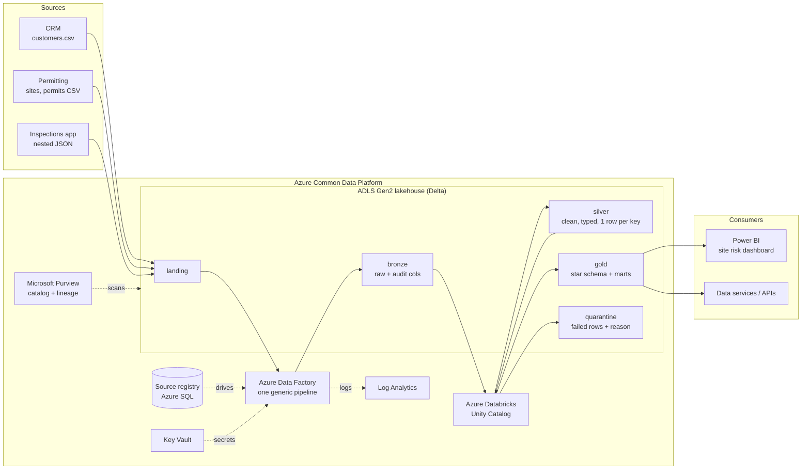
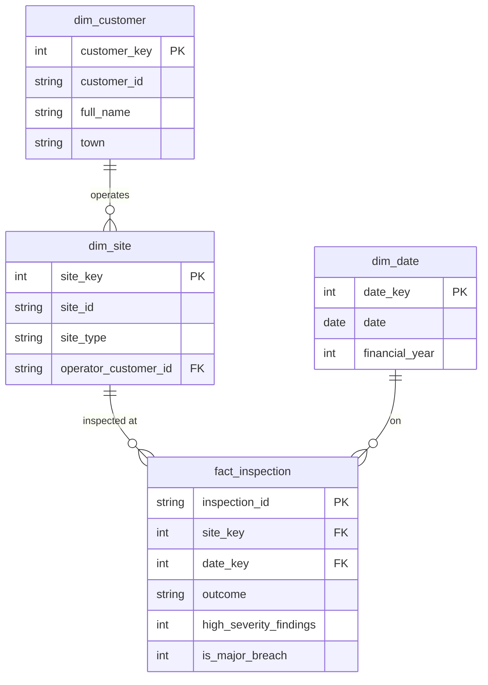

# Comment Data Platform on Azure

**A reference architecture and working prototype for a shared data platform in a public-sector agency.**
It brings data from three separate systems into one trusted place, with standards for ingestion, quality and governance, and produces a business-ready view of which permitted sites are highest risk.

> **In one minute:** three systems that never talked to each other → one metadata-driven pipeline → bronze / silver / gold lakehouse on Azure → a risk dashboard dataset the business can trust. Every bad record is kept and explained, every run leaves an audit trail, and adding a new source is a config change, not new code.

---

## 1. The problem

A regulator issues environmental permits to sites and inspects them. Its data lives in three places:

| System | Data | Format | Issue today |
|---|---|---|---|
| CRM | Operators (customers) | CSV export | Duplicate records, messy emails |
| Permitting | Sites and permits | CSV export | Separate IDs from CRM |
| Field inspections app | Inspection visits and findings | Nested JSON | Missing site links, typing errors |

Managers ask a simple question, *"Which sites should we inspect next, and who runs them?"*, but answering it means someone manually joins spreadsheets from three teams. Numbers differ between teams and nobody knows which version is right.

## 2. The solution



**How data flows**
1. **Register** – each source is a row in the source registry: format, key, owner, data classification, load type ([ADR-0002](docs/adr/0002-metadata-driven-ingestion.md)).
2. **Bronze** – one Data Factory pipeline loops the registry and lands every source *as received*, adding `_batch_id`, `_ingested_at`, `_source_file`. Append only, so any load can be replayed or audited.
3. **Silver** – data is typed, standardised and de-duplicated (latest record wins). Quality rules agreed with data owners are applied. Failing rows go to **quarantine with the reason**, never silently dropped.
4. **Gold** – a star schema (`dim_customer`, `dim_site`, `dim_date` with UK financial year, `fact_inspection`) and a mart, `mart_site_risk`, that answers the business question.
5. **Govern** – Purview scans the lake for catalog and lineage; every run writes a report with row counts and quality results.

## 3. Data model (gold)



`mart_site_risk` combines this with active permits and fees. The risk score is deliberately simple so the business can understand and challenge it:
`5 × major breaches (12m) + 2 × high-severity findings (12m) + 3 if not inspected in 12 months`.

## 4. Key decisions and trade-offs

| Decision | Why | Trade-off accepted |
|---|---|---|
| Lakehouse with medallion layers ([ADR-0001](docs/adr/0001-lakehouse-medallion.md)) | Handles CSV, JSON and files on cheap storage, clear quality stages | Needs strong standards to avoid a "data swamp" |
| One metadata-driven pipeline ([ADR-0002](docs/adr/0002-metadata-driven-ingestion.md)) | New source = config row, not new code | Registry becomes critical, so it is version-controlled |
| Managed identity only, no keys ([ADR-0003](docs/adr/0003-security-and-identity.md)) | Nothing to leak or rotate, one place to audit | Onboarding needs group membership first |
| Lakehouse for analytics, SQL / Cosmos DB for apps ([ADR-0004](docs/adr/0004-relational-vs-nosql.md)) | Right store for each workload | More than one technology to support |
| Quarantine, don't drop | Data owners can see and fix bad data at source | Extra storage and a review process |
| Databricks over Fabric for now | More control, mature Unity Catalog | Same Delta format, so a later move to Fabric stays open |

## 5. What it delivers

- **One version of the truth** for operators, sites, permits and inspections, joined across three systems.
- **Trust you can show**: the sample run quarantines 61 of 1,500 inspection records (missing site link, future date, invalid outcome code), each with its reason, and reports a pass rate per rule.
- **Faster onboarding**: a new source is one registry entry plus its silver mapping.
- **Governance built in**: every dataset has an owner and a classification, and every run leaves evidence.
- **A prioritised inspection list** (`mart_site_risk`) instead of a manual spreadsheet exercise.

## 6. Try it yourself (about 1 minute, no Azure needed)

The `cdp/` folder runs the **same bronze → silver → gold design** locally with DuckDB and Parquet, on synthetic data.

```bash
python -m venv .venv && source .venv/bin/activate
pip install -r requirements.txt
python scripts/generate_sample_data.py   # fake CRM, permits and inspections extracts
python -m cdp                            # run the platform end to end
pytest -q                                # 7 tests on the contract of each layer
```

Sample output:

```
layer   dataset                         rows
bronze  inspections.inspections         1500
silver  inspections.inspections         1439
gold    mart_site_risk                   300

Data quality (failed rows):
  inspections.inspections   site_ref_present      error    29
  inspections.inspections   not_in_future         error    13
  inspections.inspections   outcome_known         error    19
```

## 7. Deploy to Azure

```bash
az group create -n rg-cdp-dev -l uksouth
az deployment group create -g rg-cdp-dev -f infra/main.bicep -p infra/dev.bicepparam
```

Creates ADLS Gen2 (with `landing/bronze/silver/gold/quarantine`), Data Factory with managed identity, Databricks (premium, for Unity Catalog), Key Vault, Log Analytics and, optionally, Purview. RBAC is least-privilege and shared-key access is turned off. The generic ingestion pipeline is in [`adf/pl_ingest_metadata_driven.json`](adf/pl_ingest_metadata_driven.json).

## 8. Repository map

```
config/sources.json        source registry (what to load, owner, classification)
cdp/bronze.py              land raw data + audit columns
cdp/silver.py              type, clean, de-duplicate, flatten JSON
cdp/quality.py             quality rules as data, quarantine logic
cdp/gold.py                star schema + site risk mart
cdp/pipeline.py            orchestration + run report (audit and lineage)
infra/main.bicep           Azure infrastructure as code
adf/                       Data Factory metadata-driven pipeline
docs/standards/            ingestion, layer and naming standards
docs/adr/                  architecture decision records
tests/                     layer contract tests
```

## 9. What I would do next

- Move the silver/gold SQL into Databricks notebooks with Delta `MERGE` for incremental loads.
- Publish data contracts for each gold product and check them in CI.
- Add CDC ingestion from the permitting database and a document pipeline for inspection PDFs.
- Expose `mart_site_risk` through an API for the field inspections app.

---
*All data in this project is synthetic. Built as a portfolio project to show data architecture practice: patterns and standards, data modelling, governance, and clear communication.*
# Azure-Comment-Data-Platform
